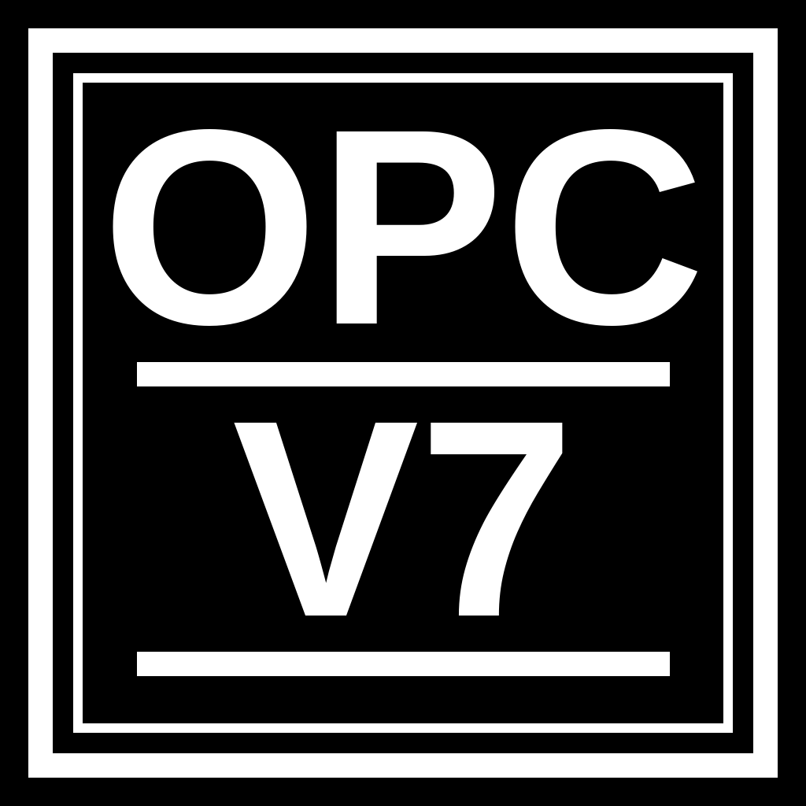

<h1 align="center">OPC V7</h1>

<b>Optimal Performance Cleaner</b> for Windows 10 and 11 by Bradley Williams

OptiCore v2, OPC V6 and the RDP Toolkit bundled into one lightweight Windows app.

Nothing to install. It runs on Windows PowerShell 5.1 and .NET Framework 4.8, which come with every copy of Windows 10 and 11, including current builds.

## Download and run

1. Grab `OPC-V7.zip` from [Releases](../../releases), or click **Code > Download ZIP**.
2. Unzip it anywhere.
3. Double-click `OPC-V7.exe` and click **Yes** on the administrator prompt.

**First run:** SmartScreen may say "Windows protected your PC" because the exe is not code-signed. Click **More info**, then **Run anyway**. To avoid that, right-click the zip, choose **Properties**, tick **Unblock**, then unzip.

If an antivirus blocks the launcher, double-click `Run-OPC-V7.cmd` instead. It starts the same app.

## What it does

| Page | What you get |
|---|---|
| **Overview** | Live CPU, memory, system drive and uptime. Drive space bars. One-click Quick clean, Recommended tune-up, Full OPC V6 run, and a System Restore shortcut. |
| **Optimizer** | Every OptiCore v2 and OPC V6 step as its own switch, grouped and labelled **Safe**, **Moderate** or **Advanced**. Presets: Quick clean, Recommended, OptiCore v2 classic, Full OPC V6. |
| **Remote Desktop** | Server side: see and switch RDP, NLA, the firewall rule and the service in one click, with this PC's IP addresses. Client side: connect by IP or name, custom port, full screen, all monitors, admin session, port test and recent hosts. |
| **Console** | Live progress and log for every run, with Stop. Each run is saved to `%LOCALAPPDATA%\OPCV7\logs`. |

Steps marked **SLOW** (SFC, DISM, Disk Cleanup, defrag) can take 10 to 40 minutes. Steps marked **RESTART** need a reboot to finish.

## Undoing changes

Keep **Create a restore point** switched on (it is part of Recommended and Full OPC V6). To roll back, go to **Overview > System Restore** and pick the point named *OPC V7 - before optimization*.

## Fixed since OPC V6

- V6 promised a restore point but never made one. V7 does.
- The standby memory purge sent the wrong command and lacked the privilege it needs, so it did nothing. Fixed.
- Telemetry scheduled tasks never actually disabled (missing trailing backslash on the task path). Fixed.
- "Pause updates for 7 days" only set one of the keys Windows reads. Now sets all of them.
- Ultimate Performance was duplicated on every run. Now created once.
- Registry tweaks failed silently when the key did not exist yet. Keys are created now.
- V6 set the execution policy to Bypass machine-wide. V7 never touches it.
- TCP chimney and NetDMA were removed from Windows 10/11, so those lines are gone, along with two tweaks that only set Windows defaults.
- Firewall reset, IP release, Windows.old removal, clearing event logs, disabling Windows Search and pausing updates were always on in V6. They are now opt-in **Advanced** steps with a clear warning. Event logs get backed up before clearing.

## Files

| File | Purpose |
|---|---|
| `OPC-V7.exe` | Launcher. Starts the app elevated with no console window. Has the script built in. |
| `OPC-V7.ps1` | The app itself (PowerShell + WPF). If it sits next to the exe, the exe runs this copy, so you can edit it directly. |
| `Run-OPC-V7.cmd` | Backup launcher. |
| `source/` | Launcher source (C#), icon and build script. |

## Good to know

- If you sign in as a standard user and type an admin password at the prompt, the per-user tweaks (visual effects, background apps, ads ID) apply to the admin account. Sign in as an admin to run those.
- Run **Release and renew IP** and **Reset Windows Firewall** at the machine, not over Remote Desktop. Both can drop your session.

## License

Perpetual Free License. Free to use, share and distribute, forever. Provided as is, without warranty.
Copyright (c) Bradley Williams.
